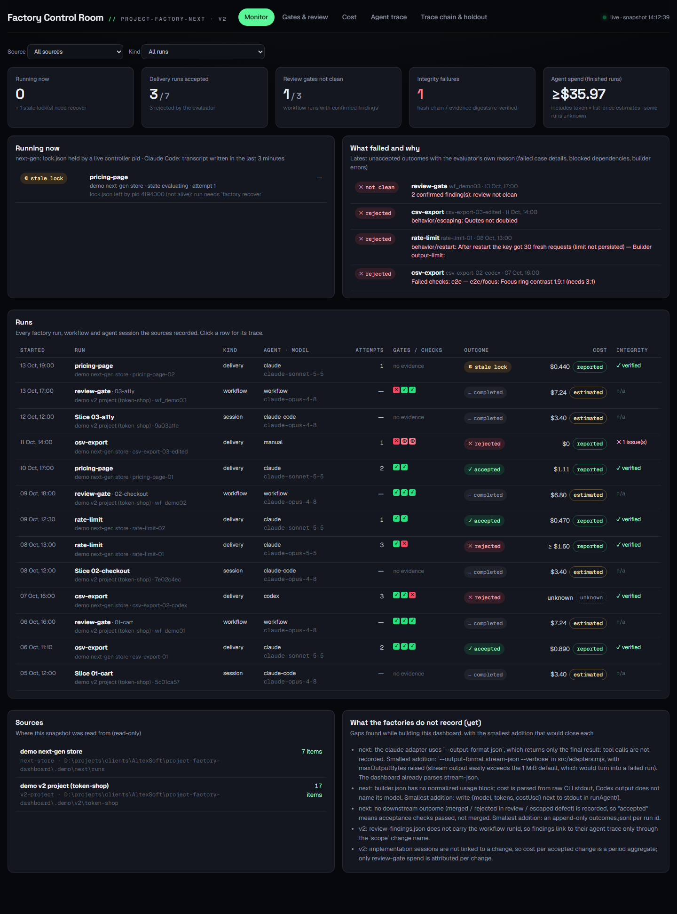
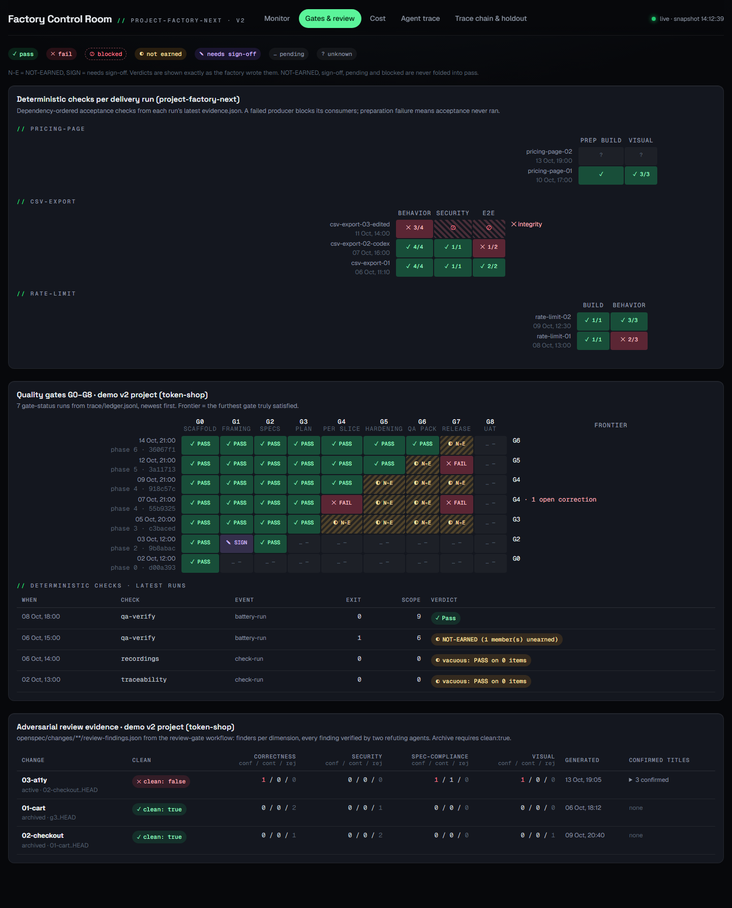
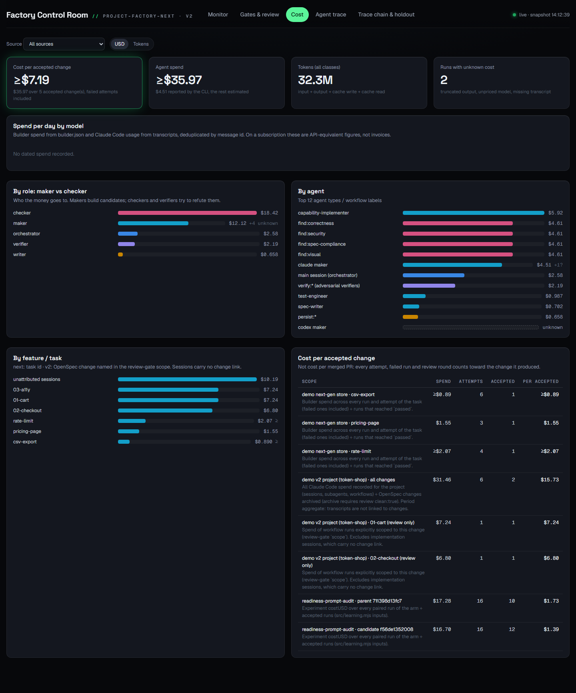
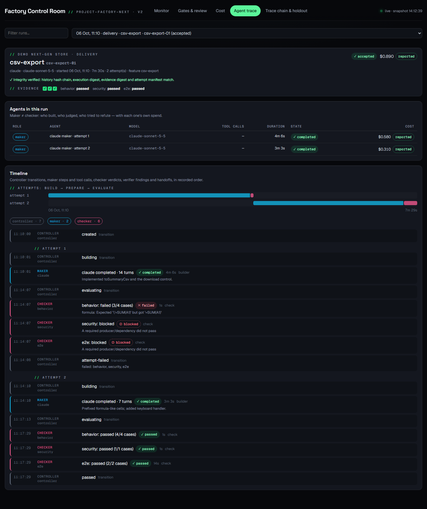
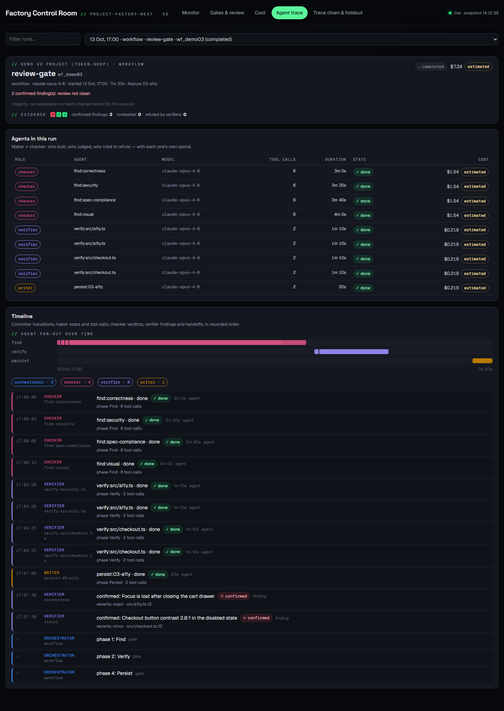
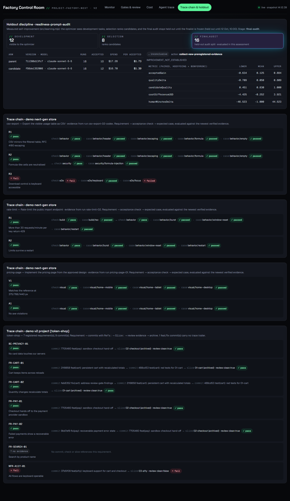

# Factory Control Room

A read-only dashboard for the agentic software factory in
[koldovsky/project-factory-next](https://github.com/koldovsky/project-factory-next), and for target projects built
with its predecessor methodology [koldovsky/project-factory](https://github.com/koldovsky/project-factory) (v2).

It answers three questions from the files the factories already write:

1. **What is the factory doing?** Runs and their states, what is running now, deterministic gate/check verdicts,
   and what failed and why (the evaluator's own case-level reason).
2. **What does it cost?** Tokens and money per run, per agent and role (maker vs checker), per feature/task, per day,
   and **cost per accepted change**: every attempt, failed run and review round counts toward the change it produced.
3. **How did the agents behave?** A timeline of each run: controller transitions, maker steps and tool calls,
   checker verdicts, adversarial verifiers' findings, handoffs between agents, and the evidence the gates produced,
   with integrity re-verified.



## Quick start (demo data)

```bash
pnpm install
pnpm demo:data      # writes a fictional but format-faithful dataset to .demo/
pnpm build
pnpm start          # http://127.0.0.1:4317, reads .demo/factory-dash.config.json when no config exists
```

`pnpm demo:data` uses a sibling `../project-factory-next` checkout (or `--factory PATH`) so the experiment
assessment is computed by the factory's own `src/learning.mjs`. To show **Running now** live, run
`pnpm demo:live` in a second terminal: it simulates a controller that holds `lock.json` with its own pid and walks
a run through two attempts.

During development `pnpm dev` serves the UI with hot reload on http://127.0.0.1:4318 and the snapshot API in the
same process.

## Point it at a factory

Copy `factory-dash.config.example.json` to `factory-dash.config.json` (git-ignored) and list your sources:

```json
{
  "sources": [
    {
      "name": "my product",
      "kind": "next-store",
      "path": "../product-runs",
      "control": ["../product-control"],
      "experiments": [{ "experiment": "../experiments/exp-1.json", "assessment": "../experiments/exp-1.assessment.json" }]
    },
    { "name": "legacy shop", "kind": "v2-project", "path": "../shop", "transcripts": "auto" }
  ],
  "pricing": {},
  "cacheFile": ".cache/transcripts.json"
}
```

- **`next-store`**: the directory you pass to `factory run --store`. `control` lists sealed control bundles
  (`task.json`) for the requirement → check trace and check dependencies. `experiments` lists the JSON you pass to
  `factory improve --experiment` and, optionally, the assessment it wrote with `--out`.
- **`v2-project`**: a project with the v2 methodology installed. `transcripts: "auto"` finds its Claude Code
  transcripts under `~/.claude/projects` by the `cwd` recorded inside them (not by folder name). Pass explicit
  folders when a project was driven from a parent folder, or `false` to skip.
- **`pricing`**: USD per million tokens, `{ "model-id": { "input", "output", "cacheWrite", "cacheRead" } }`,
  merged over the built-in Anthropic list prices ([src/core/pricing.ts](src/core/pricing.ts)). Add your Codex/OpenAI
  model here; an unpriced model stays **unknown**, it is never priced as another model.

Then `pnpm start` (or `node src/server/main.ts --config path/to/config.json --port 4317`). Relative paths resolve
against the config file. Also: `FACTORY_DASH_CONFIG=…`, and `pnpm snapshot --config … --out snapshot.json` for a
one-off JSON export. The UI refreshes every 5 seconds; the server rebuilds the snapshot at most every 4 seconds.

The dashboard only reads. It never writes into run stores or projects; the only file it writes is its own
transcript cache (`cacheFile`, optional).

## What it reads

| Source | Files | Used for |
|---|---|---|
| project-factory-next run store | `<run>/run.json` (state, hash-chained `history[]`, execution spec, evidence digests) | runs, states, attempts, timeline, **integrity** (chain, execution digest, evidence digest, attempt manifest re-verified like `src/store.mjs` / `inspectRun`) |
| | `<run>/lock.json` | **running now** (live pid) vs stale lock that needs `factory recover` |
| | `attempt-N/builder.json` | maker steps; cost from `claude --output-format json` (`total_cost_usd`, reported), `stream-json` (tool calls, usage), or `codex exec --json` (tool calls, usage → estimated) |
| | `attempt-N/evidence.json` | check verdicts (passed / failed / **blocked**), cases, preparation steps, durations |
| control bundle | `task.json` | requirement → check → expected case trace; `dependsOn` |
| experiments | `experiment.json`, `factory improve` output | holdout splits (development / selection / final audit), paired runs, `costUSD`, assessment |
| v2 project | `trace/ledger.jsonl` | G0–G8 history from `gate-status-run` (PASS / FAIL / NOT-EARNED / needs sign-off / SKIP-pending kept distinct), check and battery runs, **vacuous PASS on 0 items** |
| | `openspec/changes/**/review-findings.json` | review-gate evidence per change: dimensions, confirmed / contested / rejected, `clean` exactly as written |
| | `git log` trailers `Slice:` / `Refs:`, `docs/requirements.md` | requirement → commit → slice → review → archive trace; untraced feat/fix commits |
| Claude Code | `~/.claude/projects/<slug>/<session>.jsonl`, `…/subagents/*.jsonl` + `.meta.json` | sessions, subagent handoffs (`capability-implementer` = maker, reviewers/auditors = checkers), tool calls, tokens per model and day (usage deduplicated by `message.id`) |
| | `…/workflows/wf_*.json`, `…/subagents/workflows/<run>/agent-*.jsonl` | review-gate / spec-pipeline runs: per-agent role (`find:` checker, `verify:` verifier, `persist:` writer), tokens, cost, each finding's verdict |

### Honesty rules

The dashboard follows the factories' own rules:

- Missing, malformed or unverifiable evidence is never shown as success. A run whose hash chain or evidence digest
  no longer matches is flagged, and the trace chain prefers verified evidence.
- `blocked`, `NOT-EARNED`, `needs sign-off` and `pending` are their own states, never green.
- Every money figure says whether it is **reported** (CLI `total_cost_usd`, experiment `costUSD`), **estimated**
  (tokens × list price) or **unknown**. Unknown is never zero; sums with an unknown part are shown as `≥`.
  On a subscription, costs are API-equivalent figures, not invoices.
- **Cost per accepted change**: next-gen = builder spend over every run and attempt of a task (failed ones included)
  ÷ runs that reached `passed`. v2 = all recorded Claude Code spend for the project ÷ OpenSpec changes archived
  (archive requires review `clean: true`); review-gate spend is also attributed per change via its `scope`. The
  headline only includes scopes whose spend is known.







## Gaps in what the factories record

Found while building this; each comes with the smallest addition that would close it. None of these were changed
in the factory repositories.

1. **next: no tool-call trace for Claude builds.** The adapter uses `--output-format json`, which returns only the
   final result. Add `--output-format stream-json --verbose` in `src/adapters.mjs` and raise `maxOutputBytes`
   (stream output easily exceeds the 1 MiB default, which would turn into a failed run). The parser here already
   reads stream-json.
2. **next: no normalized usage in `builder.json`.** Cost is parsed from raw CLI stdout, which is lost when output is
   truncated; Codex output does not name its model. Write `{model, tokens, costUsd}` next to `stdout` in `runAgent()`.
3. **next: "accepted" means the acceptance checks passed, not merged.** No downstream outcome (merged, rejected in
   review, escaped defect) is recorded. An append-only `outcomes.jsonl` keyed by run id would let cost per accepted
   change use merged/kept changes.
4. **v2: `review-findings.json` does not carry the workflow `runId`**, so findings link to their agent trace only
   through the change name in `scope`.
5. **v2: implementation sessions are not linked to a change**, so v2 cost per accepted change is a period aggregate.
   A `Slice:` marker in the session (or the change name in the subagent description) would allow attribution.
6. No real `--agent claude|codex` run exists in the local data used to build this (all next-gen runs were
   `manual`), so builder parsing is tested against the documented CLI formats, not against a captured run.

## Development

```bash
pnpm test        # vitest: parsers, integrity, gates, cost, transcripts (includes the real factory-handbook-lab runs)
pnpm typecheck
pnpm shots -- --url http://127.0.0.1:4317   # README screenshots (Playwright, 1440 px)
```

Stack: Node ≥ 22.18 (TypeScript run natively by Node, no build step for the server), React 19 + Vite for the UI,
hand-written SVG charts, Vitest. The Greenfield theme tokens in `src/web/theme/` are copied unchanged from the
session-1 deck. The chart series palette was validated for lightness, chroma, colour-vision-deficiency separation
and contrast on the dark surface.

Layout:

- `src/core/` parsers and aggregation: `next-store.ts`, `builder.ts`, `next-control.ts`, `v2-project.ts`,
  `claude-code.ts`, `pricing.ts`, `snapshot.ts`
- `src/server/` HTTP server, CLI, config resolution
- `src/web/` UI (Monitor, Gates & review, Cost, Agent trace, Trace chain & holdout)
- `src/demo/builders.ts` writers for the factories' on-disk formats (tests and demo data)
- `scripts/` demo data, live-run simulator, screenshots
